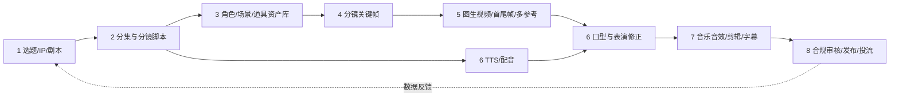

# AI 漫剧主流生成工作流调研

> 调研日期：2026-10-19  
> 范围：AI 动态漫、AI 漫画短剧、AI 动画短剧及真人感 AI 微短剧，重点关注抖音、红果、快手、B 站等竖屏消费场景。  
> 证据口径：优先采用官方文档、官方公告、GitHub 仓库、论文和法规；厂商自报效果只代表其案例；券商、研究机构与媒体数据均单独标为二手或第三方估算。

## TL;DR

1. **当前可规模化的主流方法不是“一句话生成整部剧”，而是可回滚的工业化流水线：结构化剧本 → 角色/场景资产库 → 分镜关键帧 → 逐镜短视频 → 配音/口型 → 剪辑合成 → 审核发布。**阿里云官方漫剧工坊同样把流程拆为剧本、角色、分镜等可审批节点，而不是黑盒式一次生成。[阿里云漫剧工坊](https://help.aliyun.com/zh/functioncompute/use-bailian-to-intelligently-create-comics)
2. **“一致性”主要是资产管理问题，其次才是模型问题。**可行的组合是角色 bible、服装/道具状态表、三/四视图、多参考图、必要时训练 LoRA/DreamBooth，再用首帧、尾帧或主体参考约束视频；IP-Adapter、DreamBooth 和 StoryAgent 分别提供了轻量图像参考、主体定制和跨镜头主体保持的技术证据。[IP-Adapter](https://arxiv.org/abs/2308.06721) [DreamBooth](https://arxiv.org/abs/2208.12242) [StoryAgent](https://arxiv.org/abs/2411.04925)
3. **先生成可审核的分镜图，再做图生视频，比直接文生长视频更适合连续剧生产。**原因是当前模型仍以数秒至数十秒片段为基本单位，且角色、场景和叙事状态需要在镜头边界显式传递；阿里云官方方案也将现有基模的 5–15 秒限制列为需要分镜拼接解决的问题。[阿里云漫剧工坊](https://help.aliyun.com/zh/functioncompute/use-bailian-to-intelligently-create-comics)
4. **截至 2026-10-19，闭源 API 首选应是“已经公开可调用”的 Seedance 2.5、MiniMax H3、Vidu Q4、Veo 3.1 或 Runway Gen-4.5，而不是只看发布会参数。**例如 Kling 4.0 已上线产品端，但官方公告仍写明 API“即将开放”；Sora 2 与 Videos API 已于 2026-09-24 关闭且无官方替代项。[Kling 4.0 公告](https://ir.kuaishou.com/zh-hans/news-releases/news-release-details/kelingaixinyidaimoxingklin1g-40zhengshishangxian/) [OpenAI API deprecations](https://developers.openai.com/api/docs/deprecations)
5. **Seedance 2.5 的“严格首尾帧”和“全模态参考”是互斥任务。**前者更适合精确镜头边界，后者可同时利用最多 30 图、10 视频、10 音频做主体、动作、运镜和声音参考，但提示词指定的首尾图只做语义参考，不能保证像素级一致。[火山方舟创建视频任务](https://docs.volcengine.com/docs/ark/create-video-generation-task-api?lang=zh)
6. **开源自部署的实用组合是 ComfyUI + HunyuanVideo-1.5/Wan2.x + IP-Adapter/LoRA + CosyVoice/IndexTTS + LatentSync/MuseTalk + FFmpeg。**其中 Wan2.2 官方 720P I2V 单卡命令要求至少 80GB 显存；HunyuanVideo-1.5 为 8.3B，官方的 480P 蒸馏 I2V 在 RTX 4090 上可于约 75 秒内完成一次生成，更适合作为消费级 MVP 起点。[Wan2.2](https://github.com/Wan-Video/Wan2.2) [HunyuanVideo-1.5](https://github.com/Tencent-Hunyuan/HunyuanVideo-1.5)
7. **口型不应全片使用。**动态漫可用旁白、反应镜头和少量特写规避“每句台词都对口型”的成本；需要口型时，闭源可用可灵对口型或 Hedra，开源可用 LatentSync/MuseTalk。LatentSync 1.6 官方给出的推理最低显存为 18GB，MuseTalk 官方称在 V100 上可达 30fps+，但也明确列出身份细节丢失和抖动限制。[LatentSync](https://github.com/bytedance/LatentSync) [MuseTalk](https://github.com/TMElyralab/MuseTalk)
8. **合规已进入“内容标识 + 微短剧审核 + 权利授权”三重约束。**AI 视频应在起始画面使用包含“人工智能/AI”和“生成/合成”的显式标识，文字高度不低于画面最短边的 5%，持续不少于 2 秒，并保留文件元数据隐式标识；AI 微短剧还须每集明显提示。[GB 45438-2025](https://openstd.samr.gov.cn/bzgk/std/newGbInfo?hcno=F32EA2A561F1886CD8D606513512D547) [《微短剧发展管理办法》](https://www.nrta.gov.cn/art/2026/7/31/art_1588_73827.html)
9. **市场规模没有统一可信“定值”。**艾媒估算 2025 年为 189.8 亿元、2030 年超 850 亿元；DataEye 估算 2025 年为 168 亿元、2026 年 243.6 亿元。二者模型、覆盖渠道和预测期不同，只能分别引用，不能拼接成同一增长曲线。[艾媒白皮书](https://www.iimedia.cn/c400/108457.html) [DataEye 2025 漫剧数据报告](https://www.dataeye.com/report.html?key=2025%E5%B9%B4%E6%BC%AB%E5%89%A7%E6%95%B0%E6%8D%AE%E6%8A%A5%E5%91%8A)
10. **MVP 最值得自动化的是“结构化中间产物、任务编排、缓存复用、成本/失败重试和 QA”，不是创意终审。**至少保留四个人工闸门：剧本、角色资产、分镜关键帧、最终成片；这是降低批量返工成本的关键，亦符合阿里云 HITL 方案和 Drama Skills 的“先预览确认、再调用付费接口”做法。[阿里云漫剧工坊](https://help.aliyun.com/zh/functioncompute/use-bailian-to-intelligently-create-comics) [Drama Skills](https://github.com/zenstory-ai/drama-skills)

## 一、定义、范围与形态分类

### 1.1 官方定义与本文口径

国家广电总局转载的行业解读将“漫剧”概括为“融合漫画分镜与动态视听语言的短剧形态”：以静态漫画、网络小说等为原型，在分镜画面上增加运动、配音、音效和背景音乐，形成视频化观剧体验。[国家广电总局：从“拼量”到“提质”](https://www.nrta.gov.cn/art/2026/3/26/art_3731_72968.html)

《微短剧发展管理办法》则从监管层面将微短剧定义为“单集时长少于二十分钟，主题主线明确、故事情节连续完整、人物角色突出的剧集”，并自 2026-09-01 起施行。[《微短剧发展管理办法》第二条、第五十四条](https://www.nrta.gov.cn/art/2026/7/31/art_1588_73827.html)

“动态漫”“2D/3D AI 动画短剧”“真人感 AI 短剧”目前没有统一的国家技术分类标准。下表是本文为生产设计采用的**操作性分类**，不是监管部门的正式分类：

| 形态 | 画面生产方式 | 运动与镜头 | 主要优势 | 主要风险 |
|---|---|---|---|---|
| 图文/静态漫画视频 | 漫画格、插画或少量关键帧 | 切图、推拉摇移、转场、字幕 | 成本最低、最稳定 | 容易呈现 PPT 感，平台精品化政策可能降低其商业优先级；具体分成系数无公开一手来源，未核实 |
| 动态漫 / 2.5D | 分层角色、背景、特效；或关键帧图生视频 | 局部眨眼、嘴型、粒子、景深、镜头平移 | 兼顾漫画风与产能 | 分层素材和遮挡关系管理复杂 |
| 2D AI 动画短剧 | AI 角色设定 + 逐镜关键帧 + I2V/插帧 | 全身动作、表演、运镜 | 表现力和成本较平衡 | 角色、服装、道具跨镜漂移 |
| 3D AI 动画短剧 | 3D 角色/场景、白模预演、渲染或视频模型重绘 | 可先确定走位、机位和动作，再风格化 | 空间、机位和动作更可控 | 建模、绑定、渲染与资产管理门槛更高；小云雀官方已提供 3D 导演台用于站位、动作、运镜和时间轴预演。[小云雀教程中心](https://www.xiaoyunque.com/tutorials) |
| 真人感 AI 短剧 | 写实角色参考图、数字演员、图生视频或换脸/融声 | 接近真人影视表演 | 情绪和商业广告适配度高 | 肖像、声音、公众混淆、恐怖谷和口型同步风险最高；人脸、人声编辑需单独同意。[《互联网信息服务深度合成管理规定》第十四条](https://www.cac.gov.cn/2022-12/11/c_1672221949354811.htm) |

### 1.2 常见时长、集数和画幅

- **监管上限**：单集少于 20 分钟。[《微短剧发展管理办法》](https://www.nrta.gov.cn/art/2026/7/31/art_1588_73827.html)
- **竖屏微短剧典型口径**：国家广电总局转载文章描述海外传播中的中国竖屏微短剧常见为 60–90 秒/集、50–90 集，专为手机屏幕设计。[国家广电总局：微短剧为何让海外观众“刷不停”](https://www.nrta.gov.cn/art/2025/2/21/art_3731_70229.html)
- **AI 漫剧行业口径存在冲突（二手来源）**：长江证券称 1–3 分钟/集、80–120 集；光大证券称 3–8 分钟/集、整剧 80–120 分钟。两者并非统一标准。[长江证券摘要（二手）](https://wap.hibor.com.cn/repinfodetail_4935600.html) [光大证券摘要（二手）](https://www.hibor.com.cn/data/bb0d6cb73746177c9f99dacbd9be27d0.html)
- **画幅**：面向抖音、快手、红果等手机端时通常以 9:16 为交付主版，但法规并未强制 9:16；Seedance 2.5 与 Vidu Q4 的官方文档明确支持 9:16。[Seedance 2.5](https://docs.volcengine.com/docs/ark/seedance-2-5?lang=zh) [Vidu Q4](https://platform.vidu.com/docs/reference-to-video.md)

**本文建议**：新项目先用 60–120 秒/集、9:16、每镜 3–8 秒验证留存；不要在模型层一次生成整集，而应以镜头为最小可替换单元。具体集数随 IP、平台合同和商业模式调整。

## 二、主流端到端生产工作流



生产上应同时维护四类“事实源”：**剧本事实、资产事实、镜头事实、成片事实**。每次生成任务只引用版本化事实，不把聊天记录或临时提示词当作唯一数据源；Drama Skills 与 MediaGo Drama 均采用文档驱动、可检查可修改的中间产物来保持跨阶段一致性。[Drama Skills](https://github.com/zenstory-ai/drama-skills) [MediaGo Drama](https://github.com/mediago-dev/mediago-drama)

### 2.1 阶段 1：选题、小说 IP 改编与剧本生成

**输入**：原创创意、用户画像、题材约束、小说/漫画授权文本、目标时长与集数、平台内容规则。  
**输出**：系列 bible、世界观、人物关系、剧情单元、分集大纲、单集剧本、版权与敏感项清单。

推荐将 LLM 输出固定为 JSON Schema，而不是自由文本。DeepSeek、OpenAI、Claude 和豆包均提供 JSON/结构化输出能力，适合直接生成 `episodes[]`、`scenes[]`、`dialogues[]` 等可校验数据。[DeepSeek JSON Output](https://api-docs.deepseek.com/guides/json_mode) [OpenAI Responses API](https://platform.openai.com/docs/api-reference/responses/create) [Claude Structured Outputs](https://docs.anthropic.com/en/docs/build-with-claude/structured-outputs) [火山方舟结构化输出](https://docs.volcengine.com/docs/ark/structured-output-beta?lang=zh)

| 工具/模型 | 适合任务 | 优点 | 注意点 |
|---|---|---|---|
| DeepSeek | 长文本拆解、事件链、低成本批处理 | API 提供 JSON Object/JSON Schema；可接 OpenAI 风格客户端。[DeepSeek API](https://api-docs.deepseek.com/api/create-response) | 仍需事实校验；官方提示函数参数仍可能幻觉，调用前要校验 |
| GPT | 结构化剧本、工具调用、审校 | Responses API 支持 JSON 输出和工具调用。[OpenAI Responses](https://platform.openai.com/docs/api-reference/responses/create) | 模型版本变化快，固定 model snapshot 和回归样例 |
| Claude | 长材料理解、角色动机、剧本改写 | `output_config.format` 可约束 JSON Schema。[Claude Structured Outputs](https://docs.anthropic.com/en/docs/build-with-claude/structured-outputs) | 不把“文风自然”误当作剧情事实正确 |
| 豆包 | 中文批处理、与 Seedream/Seedance 同云编排 | 方舟支持结构化输出，但官方仍标 beta。[火山方舟](https://docs.volcengine.com/docs/ark/structured-output-beta?lang=zh) | 生产端需要 schema 校验、重试和版本锁定 |
| 阅文 DramaBuddy / 小云雀剧本助手 | 网文拆书、小说改编、分集推进 | DramaBuddy 展示“理解拆书→全剧提取→整剧推进→智能导剪”；小云雀支持热点库、小说改编、系列剧与版本管理。[DramaBuddy](https://aicomic.yuewen.com/) [小云雀](https://www.xiaoyunque.com/tutorials) | 平台封装程度高，数据迁移和供应商锁定需评估 |

**关键难点**

1. **IP 权利链**：小说改编至少涉及改编权，网络发行涉及信息网络传播权；使用改编作品还应取得原作品权利人许可。[《著作权法》第十条、第十六条](http://www.npc.gov.cn/c2/c30834/202011/t20201119_308796.html)
2. **长篇压缩**：先提取不可改动事实、人物弧光和关键反转，再做剧情单元和分集，不要直接让模型从百万字正文逐集“续写”。DramaBuddy 官方页面将“理解拆书、全剧提取、剧本分镜拆解”分开处理。[DramaBuddy](https://aicomic.yuewen.com/)
3. **爽点与因果**：LLM 擅长表面格式，不天然保证跨 50 集的伏笔回收。应维护 `setup/payoff` 表和角色状态机，并在每集生成后做因果检查。
4. **内容安全前置**：在剧本阶段就按《微短剧发展管理办法》第二十五条过滤违法、不良、未成年人和虚假信息风险，避免成片后返工。[《微短剧发展管理办法》](https://www.nrta.gov.cn/art/2026/7/31/art_1588_73827.html)

### 2.2 阶段 2：分集与分镜脚本拆解

**输入**：通过审核的单集剧本、角色/场景清单、目标时长、画幅。  
**输出**：镜头表、每镜首/尾状态、关键帧描述、视频提示词、台词与音频时码。

建议镜头数据至少包含：

```json
{
  "shot_id": "EP001-SC03-SH05",
  "duration_s": 5.0,
  "shot_size": "近景",
  "camera": "轻微推近，稳定器",
  "characters": ["char_hero_v1"],
  "location": "loc_temple_night_v2",
  "wardrobe_state": "hero_battle_clean",
  "start_state": "主角右侧站立，剑尖朝下",
  "action": "抬眼、握紧剑柄、向前一步",
  "end_state": "剑尖抬至胸口，视线锁定对手",
  "dialogue": "这一剑，我替师门讨回。",
  "continuity_in": "EP001-SC03-SH04.end",
  "continuity_out": "EP001-SC03-SH06.start"
}
```

| 方法/工具 | 自动化内容 | 适用场景 |
|---|---|---|
| LLM + JSON Schema | 场次切分、镜号、景别、运镜、台词、时长、起止状态 | 自建系统；最容易接入版本控制与 QA |
| 小云雀智能预演/3D 导演台 | 多镜头统一规划、关键帧插入、角色站位、动作、运镜和时间轴预演。[小云雀教程](https://www.xiaoyunque.com/tutorials) | 复杂走位、多角色、需要白模参考 |
| DramaBuddy | 分集剧本、拆幕、角色/场景配置、宫格分镜和批量镜头推进。[DramaBuddy](https://aicomic.yuewen.com/) | 网文 IP 长线生产 |
| MovieAgent / StoryAgent | 多 Agent 模拟导演、场景规划、镜头规划与评估。[MovieAgent 论文](https://arxiv.org/abs/2503.07314) [StoryAgent 论文](https://arxiv.org/abs/2411.04925) | 研究、自建 Agent 原型 |

**关键难点**

- **时长守恒**：镜头时长总和必须等于单集目标时长；台词时长要先按 TTS 结果回填，不能只用字数估算。
- **可生成性**：一个镜头只承载一个主动作和一个主要摄影意图；复杂连续动作应拆镜，否则视频模型容易丢动作或改变主体。
- **竖屏构图**：优先中近景、单/双人构图，谨慎使用超宽大全景；关键字幕和人物脸部需避开平台 UI 安全区。具体安全区尺寸依平台上传端为准，本次未找到统一公开标准。
- **镜头边界状态**：每镜必须写 `start_state/end_state`，才能使用首尾帧或上一镜尾帧承接。

### 2.3 阶段 3：角色设定与一致性

**输入**：角色文字设定、风格样张、合法授权的人脸/声音素材。  
**输出**：角色 bible、标准立绘、三/四视图、表情表、服装状态、道具表、角色引用 ID、可选 LoRA。

**推荐的一致性分层**

1. **语义层**：固定姓名、年龄段、体型、脸型、发型、服装主色、标志物和禁改项。
2. **视觉资产层**：标准正面、3/4、侧面、背面、近景脸、全身、表情表；同一造型使用不可变的 asset ID。
3. **参考控制层**：生成每个分镜时显式传入角色、服装、场景、道具参考，不只复述文字。
4. **模型定制层**：高频主角或长剧训练角色 LoRA/DreamBooth；DreamBooth 原论文以约 3–5 张主体图进行个性化微调。[DreamBooth](https://arxiv.org/abs/2208.12242)
5. **时间连续层**：上一镜尾帧作为下一镜首帧或视觉记忆；StoryMem 研究用动态关键帧记忆库提升多镜头长程一致性，但复杂多角色和大动作转场仍是其已知限制。[StoryMem](https://arxiv.org/abs/2512.19539)

| 工具/方法 | 一致性机制 | 适合场景 | 限制 |
|---|---|---|---|
| IP-Adapter | 冻结基础模型，以解耦交叉注意力加入图像提示，原论文约 22M 参数。[IP-Adapter](https://arxiv.org/abs/2308.06721) | SD/SDXL 自建、多角色参考 | 对极细服装纹样和多主体身份仍需分区域或多次合成 |
| DreamBooth / 视觉 LoRA | 用少量主体图把角色绑定到标识词；LoRA 通过低秩增量降低微调参数量。[DreamBooth](https://arxiv.org/abs/2208.12242) [LoRA](https://arxiv.org/abs/2106.09685) | 高频主角、固定画风 | 训练数据和授权责任由制作方承担；过拟合会降低姿态多样性 |
| FLUX.1 Kontext / FLUX.2 | 参考图编辑、多轮一致性；官方新项目推荐 FLUX.2，多参考最多 10 图。[BFL 文档](https://docs.bfl.ai/kontext/kontext_image_editing) | 快速闭源/API 资产迭代 | 是“编辑保持”而非绝对身份锁定 |
| Gemini/Nano Banana | 多图输入、对话式编辑、跨轮次保持；当前官方图像文档列出 Nano Banana 系列。[Gemini 图像文档](https://ai.google.dev/gemini-api/docs/image-generation) | 多轮修图、角色+场景融合 | API 模型名和限制更新快，需运行时查询 |
| GPT Image | 多图编辑、mask、Responses API 多轮编辑。[OpenAI Image Guide](https://developers.openai.com/api/docs/guides/image-generation) | 局部修图、资产纠错 | mask 是引导，不保证严格像素边界 |
| Seedream | 单/多参考图、主体一致性、交互编辑和图层拆分；5.0 Pro 支持 2–10 张参考图。[Seedream API](https://docs.volcengine.com/docs/ark/image-generation-api?lang=zh) | 中文工作流、角色/服装/场景合成 | 参考角色越多，身份串扰概率越高 |
| Midjourney | V8.1/8.2 Edit Model 支持最多 4 张参考图，替代早期 Character/Omni Reference。[Midjourney Edit Model](https://docs.midjourney.com/hc/en-us/articles/48495453462797-Edit-Model) | 风格探索、概念图 | 不适合作为无头 API 流水线核心；细小标志仍可能漂移 |
| 即梦/可灵主体参考 | 产品端可作为角色参考与视频主体约束 | 快速人工生产 | 本次未找到稳定、完整的一站式官方 API 说明；按具体版本和地区实测 |

**关键难点与治理**

- 角色“像不像”要拆成脸、发型、体型、服装、道具五项评分，不能只算人脸相似度。
- 每镜生成后自动提取人脸 embedding、服装颜色、道具检测和场景 embedding，超过阈值进入人工复核；这是本文建议，不能完全替代人工审美判断。
- 真人感角色必须记录肖像/声音授权书、用途、期限和地区。广电总局 2026 年座谈会形成的行业共识是任何“融像”“融声”均须取得权利人明确授权。[广电总局“融像”“融声”座谈会](https://www.nrta.gov.cn/art/2026/9/4/art_114_74033.html)

### 2.4 阶段 4：场景与分镜图生成

**输入**：镜头表、角色/服装/场景/道具资产、风格规范、9:16 构图。  
**输出**：可审核的首帧、可选尾帧、景别变体、深度/姿态/遮罩等控制图。

| 工具 | 强项 | 编排方式 | 注意点 |
|---|---|---|---|
| Seedream 5.0 Pro | 中文理解、多参考融合、坐标/框选编辑、最多 16 个图层拆分。[Seedream 5.0](https://docs.volcengine.com/docs/ark/seedream-5-0-pro?lang=zh) | API 批量生成 + 人工选片 | 资产 URL 需及时落库，官方返回链接有时效 |
| FLUX.2 / Kontext | 多参考编辑、角色迭代、风格转换。[BFL 多参考编辑](https://docs.bfl.ai/guides/prompting_editing_multi_reference) | API 或自建兼容实现 | 不同 FLUX 权重许可证不同，商用前逐项核对 |
| Gemini/Nano Banana | 多轮编辑、多图融合、文字和世界知识 | Gemini API | 不同型号的多图上限和价格不同，以实时文档为准 |
| GPT Image | 高保真编辑、mask、多轮修改 | Images/Responses API | 适合“修”而非一次性赌最终图 |
| Midjourney | 风格探索和高质量概念图 | Web/Discord 人工工作流 | 缺少适合作为核心生产线的公开官方 API |
| SD/SDXL + IP-Adapter + ControlNet | 可私有化、可训练、姿态/深度/线稿控制 | ComfyUI 节点图 | 需要模型、插件、显存、版本和许可证治理 |
| ComfyUI | 节点图、异步队列、缓存、工作流 JSON；官方支持 SDXL、FLUX、Wan、HunyuanVideo 等。[ComfyUI README](https://github.com/Comfy-Org/ComfyUI) | 本地/服务器图形管线 | UI workflow 与 API prompt 并非完全同构，部分自定义节点需前端序列化。[ComfyUI issue](https://github.com/Comfy-Org/ComfyUI/issues/6895) |

**关键难点**：同镜多角色容易身份串扰，重复场景容易在布局、光向和道具位置上漂移，竖屏构图还要同时给字幕与平台 UI 留出安全区。解法是分角色/背景生成后再合成、复用场景母版、显式传入姿态/深度/遮罩，并在人审通过前不进入视频阶段。

**实践要点**

- 先批量生成低成本 contact sheet，再只对入选镜头高清重绘。
- 同场景建立“母版空镜”，后续镜头只变机位、人物和局部道具。
- 先冻结关键帧再生成视频；关键帧不合格时不要进入高成本 I2V。
- 对 2.5D 动态漫，可让 Seedream 图层拆分或本地分割模型输出角色、背景、前景、特效层，再用 AE/FFmpeg/Canvas 做轻运动；Seedream 官方明确支持底图 + 最多 16 个透明图层。[Seedream 5.0 Pro](https://docs.volcengine.com/docs/ark/seedream-5-0-pro?lang=zh)

### 2.5 阶段 5：图生视频、首尾帧与多主体参考

**输入**：冻结关键帧、动作/运镜提示词、参考角色/场景/动作/音色、目标秒数。  
**输出**：逐镜视频、尾帧、生成参数、成本、失败原因与候选版本。

| 模型/平台 | 已核实能力（截至 2026-10-19） | 适合 | 关键限制 |
|---|---|---|---|
| Kling 4.0 | 产品端最长 30 秒；全能参考合计最多 15 项；最多 10 张关键帧；支持 MCP/CLI。[快手官方公告](https://ir.kuaishou.com/zh-hans/news-releases/news-release-details/kelingaixinyidaimoxingklin1g-40zhengshishangxian/) | 高动态、复杂运镜、人工精修 | 公告称 API“即将开放”，故不作为当前稳定 API MVP；4K、续拍 2 分钟等措辞包含“将支持” |
| Seedance 2.5 | 4–30 秒；最多 30 图 + 10 视频 + 10 音频；支持有声视频、编辑、延长、严格首/尾帧。[官方教程](https://docs.volcengine.com/docs/ark/seedance-2-5?lang=zh) | 中文 API、长镜头、多模态参考 | 首帧、首尾帧、全模态参考三种任务互斥；参考素材多不等于稳定，官方建议 1–5 主体更稳 |
| MiniMax H3 | 4–15 秒、768P/2K；支持首帧/尾帧、最多 9 图/3 视频/3 音频的参考生成。[MiniMax Video Guide](https://platform.minimax.io/docs/guides/video-generation) | 角色/动作/声音综合参考 | 混合输入总计最多 12 文件，参考视频/音频总时长各不超过 15 秒 |
| Vidu Q4 Preview | 1–15 张参考图、3–16 秒、540p–4K、可音画同出与智能切镜。[Vidu API](https://platform.vidu.com/docs/reference-to-video.md) | 多主体和漫剧参考生视频 | Q4 Preview 当前不支持旧式 subject invocation；应按图片数组和提示词引用 |
| Veo 3.1 | 场景/人物/物体 ingredients、原生音频、首尾帧、场景延长。[Google DeepMind](https://deepmind.google/models/veo/) | 电影感、声画一体、高质量镜头 | 官方仍承认短语音的自然度和同步是持续改进项 |
| Runway Gen-4.5 | API 支持文/图生视频，2–10 秒；首帧输入，API 版本亦定义 first/last keyframe 结构。[Runway API](https://docs.dev.runwayml.com/api.md) | 国际化生产 API、ProRes/HDR 输出 | 不同模型允许的 keyframe position 不同，必须按 model schema 发送 |
| Pika 2.5 | 官方 I2V API，720p/1080p，5 或 10 秒，异步任务。[Pika API](https://dev.pika.art/models/pika/pika-2.5/image-to-video) | 简单图生视频、快速候选 | 当前该端点是单图 I2V，不是长剧情/多主体一致性核心 |
| Sora 2 | **不再可作为 API 方案**：Videos API、`sora-2` 和 `sora-2-pro` 于 2026-09-24 关闭，官方替代栏为空。[OpenAI deprecations](https://developers.openai.com/api/docs/deprecations) | 仅作为历史能力参考 | 不得写入新 MVP 的可调用依赖 |
| Wan2.2 | 开源 T2V/I2V/TI2V/S2V/Animate；I2V 480P/720P，官方单卡命令至少 80GB 显存。[Wan2.2 README](https://github.com/Wan-Video/Wan2.2) | 私有化、高显存服务器、语音驱动视频 | 上游仓库的模型表未列独立 FLF2V；严格首尾帧官方模型在 Wan2.1，ComfyUI 另提供基于 Wan2.2 I2V 的 FLF 工作流 |
| Wan2.1 FLF2V | 独立 14B 首尾帧模型，仅 720P。[Wan2.1 README](https://github.com/Wan-Video/Wan2.1) | 严格开/闭镜状态和转场 | 硬件成本高；不要误写为 Wan2.2 上游原生 FLF2V |
| HunyuanVideo-1.5 | 8.3B，支持 480P/720P T2V/I2V；480P 蒸馏 I2V 官方称 RTX 4090 可在 75 秒内生成。[HunyuanVideo-1.5](https://github.com/Tencent-Hunyuan/HunyuanVideo-1.5) | 单机开源 MVP | 仍是逐镜生成；长剧情需外部状态和资产编排 |

**关键难点**

- **动作可控性**：把动作写成“主体 + 起始状态 + 单一动作 + 结束状态 + 相机 + 环境反馈”，避免抽象的“激烈战斗”。
- **多主体身份串扰**：为角色编号并明确空间关系；优先拆成过肩、单人反应和双人中景，少用多人全景长对白。
- **镜间连续**：使用上镜尾帧、场景母版和角色状态；VGoT 研究将跨镜身份 token、动态故事线和相邻 latent 过渡作为三类独立问题，说明单靠一个 prompt 无法同时解决。[VideoGen-of-Thought](https://arxiv.org/abs/2412.02259)
- **异步与失败治理**：所有 API 任务保存 provider、model、request、seed、asset hash、task id、价格、状态和输出 URL；下载后做内容哈希，避免供应商临时 URL 失效。

### 2.6 阶段 6：配音、声音设计与对口型

**输入**：台词、人物音色表、情绪、语速、停顿、镜头视频。  
**输出**：逐句音频、句/字时间戳、混音轨、口型版镜头。

#### TTS / 音色

| 工具 | 已核实能力 | 适用 |
|---|---|---|
| ElevenLabs | TTS、Instant/Professional Voice Cloning；官方 API 先创建 voice，再按 `voice_id` 合成。[ElevenLabs TTS](https://elevenlabs.io/docs/overview/capabilities/text-to-speech) [Voice Clone API](https://elevenlabs.io/docs/api-reference/voices/ivc/create) | 多语言、海外版本 |
| MiniMax Speech | Speech 2.8、同步/异步长文本、声音克隆与 voice design；异步长文本最多 100 万字符并可返回句级时间戳。[MiniMax API Overview](https://platform.minimax.io/docs/api-reference/api-overview) | 中文长对白、批量旁白 |
| 火山/豆包语音 | TTS 2.0、声音复刻 2.0、流式 HTTP；官方建议复刻样本 14–30 秒、低噪声、单人、情绪稳定。[豆包 TTS](https://docs.volcengine.com/docs/DoubaoVoice/unidirectional-streaming-text-to-speech-http?lang=zh) [复刻最佳实践](https://docs.volcengine.com/docs/DoubaoVoice/SoundReplication20BestPractices?lang=zh) | 与方舟/Seedance 同云编排 |
| CosyVoice | 开源多语言语音生成，仓库包含推理、训练和部署。[CosyVoice](https://github.com/FunAudioLLM/CosyVoice) | 自部署中文 TTS |
| IndexTTS | 开源可控零样本 TTS 系统。[IndexTTS](https://github.com/index-tts/index-tts) | 自部署声音克隆/情感控制 |

#### 口型

| 工具 | 已核实能力 | 限制/建议 |
|---|---|---|
| 可灵对口型 API | 可灵开放平台提供独立对口型与人脸检测接口。[Kling API 索引](https://klingai.com/document-api/llms.txt) | 先做人脸检测；具体限额随 API 版本查询 |
| Hedra Character 3 | 单张起始图 + 必选音频生成说话/唱歌视频，官方模型页和 API 页标称最长 10 分钟。[Hedra Character 3](https://www.hedra.com/develop/models/video/hedra-character-3) | 文件规格页仍把 Character-3 标为 legacy 且写 5 分钟，官方页面存在冲突；生产前应实际调用确认 |
| LatentSync 1.6 | 音频条件 latent diffusion，512×512；官方称推理最低 18GB 显存。[LatentSync README](https://github.com/bytedance/LatentSync) | 高 guidance 可能引入变形/抖动；适合局部特写 |
| MuseTalk 1.5 | 音频驱动口型，官方称 V100 可 30fps+，支持中英日等。[MuseTalk](https://github.com/TMElyralab/MuseTalk) | 官方列出胡须、唇形/颜色细节丢失和单帧管线抖动 |
| Wan2.2 S2V | 图像 + 音频生成说话视频，也可联动 CosyVoice。[Wan2.2 README](https://github.com/Wan-Video/Wan2.2) | 官方单卡 S2V 命令同样至少 80GB 显存 |

**关键难点**：音色稳定、情绪自然、专有名词读音、台词时长和镜头时长必须同时满足；口型模型还可能破坏脸部身份。应先锁定最终音频和时间戳，再处理少量对白特写，并保留无口型原镜头作为回退。

**实践建议**

- TTS 先于视频最终定时：用真实音频时长回写镜头表，再决定镜头长度。
- 为每个角色维护固定 `voice_id`、语速、音高、情绪和发音词典。
- 只在近景/特写做口型，旁白、背影、遮挡、反应镜头不做；这能减少口型模型对脸部身份的破坏。
- 音色克隆必须取得声音权利人的明确授权，并保存授权证据。[广电总局“融声”共识](https://www.nrta.gov.cn/art/2026/9/4/art_114_74033.html)

### 2.7 阶段 7：音乐、音效、剪辑合成与字幕

**输入**：逐镜视频、对白、旁白、BGM、环境声、拟音、字幕文本、平台交付规格。  
**输出**：成片、纯净版、字幕文件、音轨 stem、封面、审核代理文件。

| 工具 | 作用 | 注意点 |
|---|---|---|
| 剪映/CapCut | 时间线剪辑、模板、自动字幕、多语言字幕和人工修订。[CapCut Auto Captions](https://www.capcut.com/tools/auto-caption-generator) | 素材库音乐并非都可商用；官方许可协议对使用场景有限制，上线前逐曲核查。[CapCut Materials License](https://www.capcut.com/clause/material-license-agreement) |
| FFmpeg | 批量拼接、转码、字幕烧录、画幅、响度标准化和多轨混音；官方滤镜包含 `concat`、`subtitles`、`loudnorm`。[FFmpeg Filters](https://ffmpeg.org/ffmpeg-filters.html) | 适合确定性批处理，不替代人工节奏剪辑 |
| DAW/NLE | 人工对白清理、ducking、音乐节拍点、复杂转场 | Premiere/Resolve/AE 等具体选择按团队栈决定 |
| AI 音效/音乐 | 可由 Seed Audio、ElevenLabs Sound Effects 等生成；火山官方模型表列出最长 2 分钟的 Seed Audio 1.0。[火山语音模型列表](https://docs.volcengine.com/docs/DoubaoVoice/model-list?lang=zh) | 生成服务条款、训练数据和音乐商用权需单独核查 |

**关键难点**：不同模型生成的镜头在帧率、分辨率、色彩和运动强度上不统一；音乐/字体/音效的商用权、字幕时码和人声可懂度也必须逐项治理。确定性转码和响度处理交给 FFmpeg，叙事节奏与最终听感保留人工精修。

**自动化检查**

1. 镜头时长、全片时长、黑帧、静帧、花屏、重复帧。
2. 字幕与台词一致、错别字、敏感词、字幕越界。
3. 对白峰值、整体响度、削波、静音缺口。
4. 角色/服装/道具连续性抽检。
5. 片头剧名、节目编号/许可证号、AI 显式标识和片尾署名。

### 2.8 阶段 8：审核、发布与投流

**输入**：成片、权利文件、备案/许可信息、AI 标识、封面标题、投放素材。  
**输出**：平台审核版本、发布记录、投流计划、留存/完播/付费数据。

#### 全国性硬要求

1. **微短剧分类审核**：办法将微短剧分为一、二、三类；一、二类播前申请审核许可，三类由符合条件的播出单位播前审核并标节目编号；未取得相应许可/批准/节目编号不得播出。[《微短剧发展管理办法》第五条、第十七条](https://www.nrta.gov.cn/art/2026/7/31/art_1588_73827.html)
2. **AI 每集提示**：使用 AI 技术生成、制作的微短剧，制作机构与播出单位应在每集明显位置添加提示标识。[《微短剧发展管理办法》第三十四条](https://www.nrta.gov.cn/art/2026/7/31/art_1588_73827.html)
3. **显式 + 隐式标识**：《人工智能生成合成内容标识办法》要求视频起始画面和播放周边显著提示，文件元数据添加隐式标识；发布者应主动声明，任何组织个人不得恶意删除、篡改、伪造或隐匿标识。[网信办《标识办法》](https://www.cac.gov.cn/2025-03/14/c_1743654684782215.htm)
4. **标识技术规格**：GB 45438-2025 规定视频标识文字需同时包含“人工智能/AI”与“生成/合成”，位于边或角，文字高度不低于最短边 5%，正常播放持续不少于 2 秒。[GB 45438-2025](https://openstd.samr.gov.cn/bzgk/std/newGbInfo?hcno=F32EA2A561F1886CD8D606513512D547)
5. **肖像与声音**：提供人脸、人声编辑功能应提示用户依法告知被编辑者并取得其单独同意；可能导致公众混淆或误认的合成人声、人脸/姿态操控等应显著标识。[《深度合成管理规定》第十四、十七条](https://www.cac.gov.cn/2022-12/11/c_1672221949354811.htm)

#### 平台侧已核实信息

| 平台 | 已核实要求/能力 | 未核实或需登录后台确认 |
|---|---|---|
| 抖音/红果 | 抖音规则中心公开列有 AI 生成内容平台规范、水印与元数据规范；短剧创作者中心面向版权方开展成品剧合作。[抖音规则中心](https://www.douyin.com/rule/main) [短剧创作者中心](https://www.shortdramas.com/) | 红果漫剧的具体上传页面、片头秒数、字体大小、分成系数、保底和投流政策未找到完整公开一手规则；以登录后的合同/后台为准 |
| 快手 | 短剧小程序需相应制作经营资质、ICP备案和内容备案；行业播放器展示备案号、AI 标签和异常状态，`showAiTag` 默认 `true`。[快手短剧方案](https://open.kuaishou.com/docs/new_industry_solution/vertical_industry_solution/shortplay_solution) [行业播放器](https://open.kuaishou.com/docs/operate/specification/integrationGuide/developerGuide.html) | 漫剧专项扶持金额、分账比例未找到官方公开公告 |
| B 站 | 本次调研未找到专门面向“AI 漫剧”的公开上传/分账细则 | 应按国家 AI 标识、微短剧审核要求及 B 站实时社区规则执行；具体入口和商业合作需平台确认 |

**关键难点**：国家规则、微短剧分类审核、平台合同和投流审核并不是同一套流程，且不同平台公开信息完整度差异很大。应让每个成片版本绑定对应的权利文件、许可/节目编号、AI 标识和平台审核记录，避免“改片后沿用旧审核材料”。

**投流建议（本文建议）**

- 用 3–5 集小样做 A/B：前 3 秒钩子、封面、标题、单集结尾 cliffhanger。
- 把自然流量和付费流量分开归因，记录每版素材、投放人群、完播率、下一集率、付费/广告回收。
- 不要用投流掩盖剧情问题；先通过小流量验证首集留存和 3 集连看，再扩大预算。

## 三、一站式漫剧平台与 Agent 产品

| 平台/产品 | 已自动化环节 | 证据性质与边界 |
|---|---|---|
| 字节小云雀 | 剧本助手、角色/场景资产画布、智能预演、3D 导演台、图片/视频生成、运镜库、重制转绘与导出。[小云雀官方教程](https://www.xiaoyunque.com/tutorials) | 一手产品教程；具体模型额度和 API 能力随账号变化 |
| 火山剧创 | 定位为剧本到成片的剧创产品，入口见官方文档。[火山剧创产品说明](https://docs.volcengine.com/docs/drama-creation/product-description?lang=zh) | 官方文档当前公开抓取信息有限，具体功能需控制台核验 |
| 腾讯 WorkRally | AI 生图、4 类视频驱动、提示词优化、无限画布、项目/媒资管理、MCP 透传。[WorkRally](https://github.com/Tencent/workrally) | 腾讯开源 Agent Skill/CLI；仓库未声明标准 SPDX 许可证，商用前核查 |
| 腾讯云创意工坊 | 剧本、角色、分镜、关键帧、视频、配音、时间线剪辑、2K/4K 超分，多模型画布。[腾讯云开发者文章](https://cloud.tencent.com/developer/article/2680522) | 厂商技术文章，能力与效果需以商务开通和实测为准 |
| 阿里云漫剧工坊 | 千问 + 万相，覆盖剧本、角色、分镜、视频和自动拼接；每个节点可人工审批。[阿里云帮助中心](https://help.aliyun.com/zh/functioncompute/use-bailian-to-intelligently-create-comics) | 一手方案文档；“15 分钟、不超过 70 元”是官方体验示例，不是行业单集成本 |
| 百度 Hogee AI 制片组 | 灵感/小说/剧本到分镜、角色三视图、图像/视频模型调度、成片及私有化。[百度智能云](https://cloud.baidu.com/product/Hogee/aidrama.html) | 官方产品页；“成本直降 90%”“分钟级交付”属于厂商宣传，不能视作普遍实测 |
| 阅文 DramaBuddy | 拆书、全剧提取、分镜、批量镜头、智能导剪、团队协同、IP/接单生态、CLI/Skill 接入。[DramaBuddy](https://aicomic.yuewen.com/) | 官方产品页；“一人一天一部剧”为产品口号/示例，不代表所有项目 |
| 快手“造梦专家 2.0” | 据广电总局转载文章描述，是“剧本—分镜—视频”一站式平台。[广电总局转载](https://www.nrta.gov.cn/art/2026/3/26/art_3731_72968.html) | **二手来源**，本次未找到独立官方产品文档或 API，完整能力未核实 |
| 即梦 Octo | 媒体报道将其描述为全链路创作/内测产品 | **二手来源、未核实**；本报告不把它列入可采购能力清单 |

判断一站式平台时，应重点问四件事：中间产物能否导出、是否支持自带模型/API、失败任务和成本是否可追踪、角色/场景资产能否跨项目复用。界面上“全流程”不等于工程上可迁移。

## 四、开源与自建方案

### 4.1 基础模型与编排

- **ComfyUI**：节点图编排、异步队列、缓存和工作流 JSON，适合把 SDXL/FLUX、IP-Adapter、ControlNet、Wan、HunyuanVideo 与后处理组合起来。[ComfyUI](https://github.com/Comfy-Org/ComfyUI)
- **Wan2.2**：T2V/I2V/TI2V/S2V/Animate，适合高显存服务器；官方 I2V/S2V 单卡示例至少 80GB。[Wan2.2](https://github.com/Wan-Video/Wan2.2)
- **HunyuanVideo-1.5**：8.3B、480P/720P T2V/I2V，消费级 GPU 门槛较低；官方发布了训练和 LoRA 脚本。[HunyuanVideo-1.5](https://github.com/Tencent-Hunyuan/HunyuanVideo-1.5)
- **IP-Adapter + LoRA/DreamBooth**：分别解决免训练图像参考和高频主体定制。[IP-Adapter](https://github.com/tencent-ailab/IP-Adapter) [DreamBooth](https://arxiv.org/abs/2208.12242)
- **CosyVoice/IndexTTS + LatentSync/MuseTalk**：自建中文语音和口型链路。[CosyVoice](https://github.com/FunAudioLLM/CosyVoice) [IndexTTS](https://github.com/index-tts/index-tts) [LatentSync](https://github.com/bytedance/LatentSync) [MuseTalk](https://github.com/TMElyralab/MuseTalk)

### 4.2 Story-to-video / 漫剧 Agent 项目

下表 Star 数和“最近推送”通过 GitHub API 于 2026-10-19 查询；Star 只表示关注度，最近推送不等于稳定发布，许可证仍应检查仓库具体文件和模型权重条款。

| 项目 | 作用 | Stars | 最近推送 | 代码许可证/注意 |
|---|---|---:|---|---|
| [ComfyUI](https://github.com/Comfy-Org/ComfyUI) | 通用节点式生成编排 | 138,972 | 2026-10-19 | GPL-3.0 |
| [Wan2.2](https://github.com/Wan-Video/Wan2.2) | 开源视频基础模型与推理 | 18,009 | 2026-09-21 | Apache-2.0；权重用途另核 |
| [HunyuanVideo-1.5](https://github.com/Tencent-Hunyuan/HunyuanVideo-1.5) | 轻量 T2V/I2V、训练/LoRA | 4,570 | 2026-04-10 | GitHub API 未返回 SPDX；核查仓库 LICENSE/模型条款 |
| [ViMax](https://github.com/HKUDS/ViMax) | Idea/Script/Novel-to-Video，多 Agent、关键帧、镜头和最终拼接 | 12,692 | 2026-09-30 | MIT |
| [Drama Skills](https://github.com/zenstory-ai/drama-skills) | 原著→剧本→资产→分镜→生产→剪辑→审查的 11 个 Agent Skills | 3,055 | 2026-10-15 | MIT |
| [AIComicBuilder](https://github.com/LingyiChen-AI/AIComicBuilder) | 剧本导入、角色四视图、分镜、首尾帧、视频和字幕合成 | 1,919 | 2026-04-27 | Apache-2.0 |
| [CineGen-ShortDrama](https://github.com/UllrAI/CineGen-ShortDrama) | Script→Asset→Keyframe，Gemini/Veo 工作台 | 554 | 2026-09-25 | 非标准/未识别许可证，二开商用前必须核查 |
| [WorkRally](https://github.com/Tencent/workrally) | 腾讯 AIGC 漫剧 Agent Skill/CLI、画布与媒资 | 173 | 2026-09-29 | GitHub API 未返回 SPDX |
| [MediaGo Drama](https://github.com/mediago-dev/mediago-drama) | 本地文档驱动的小说→剧本→设定→分镜→素材→视频工作台 | 94 | 2026-07-30 | Apache-2.0 |

配套模块元数据：

| 项目 | Stars | 最近推送 | 用途 |
|---|---:|---|---|
| [CosyVoice](https://github.com/FunAudioLLM/CosyVoice) | 24,042 | 2026-05-25 | TTS，Apache-2.0 |
| [IndexTTS](https://github.com/index-tts/index-tts) | 24,578 | 2026-09-29 | 零样本可控 TTS；GitHub API 未返回 SPDX |
| [IP-Adapter](https://github.com/tencent-ailab/IP-Adapter) | 6,704 | 2024-06-28 | 图像参考适配器，Apache-2.0 |
| [LatentSync](https://github.com/bytedance/LatentSync) | 6,167 | 2025-06-20 | 口型同步，Apache-2.0 |

### 4.3 研究型长剧情方案

| 项目/论文 | 核心方法 | 对工程的启示 |
|---|---|---|
| [StoryAgent](https://arxiv.org/abs/2411.04925) | 故事、分镜、视频、协调和评估 Agent；以主体移除/重绘与 LoRA-BE 提升一致性 | 角色一致性需要独立分镜资产管线和质量评估，不应只靠视频模型 |
| [MovieAgent](https://arxiv.org/abs/2503.07314) | Director、Scene Plan、Shot Plan 的分层 CoT，多场景多镜头生成 | 把故事→幕→场→镜头做层级规划，适合映射成任务 DAG |
| [VideoGen-of-Thought](https://arxiv.org/abs/2412.02259) | 动态故事线、跨镜身份传播、相邻 latent 过渡 | 叙事、身份、转场是三个不同的质量目标 |
| [StoryMem](https://arxiv.org/abs/2512.19539) | 动态关键帧记忆库驱动逐镜生成 | 自建系统可用“固定锚点 + 滑动窗口”保存历史视觉状态；仍需处理复杂多角色歧义 |

这些项目证明“逐镜生成 + 显式记忆/资产 + 分层规划”是当前长剧情的共同方向，但论文指标和 demo 不等于商业剧集的可直接产能。

## 五、关键技术难点与当前解法

| 难点 | 典型症状 | 当前有效解法 | 仍未解决的部分 |
|---|---|---|---|
| 角色一致性 | 换脸、发型/年龄/体型漂移 | 角色 bible、三/四视图、多参考、IP-Adapter、高频角色 LoRA、embedding QA | 复杂表情、极端角度、多角色遮挡仍会漂移 |
| 场景一致性 | 门窗、光向、空间关系变化 | 场景母版、空镜多视图、3D 白模、深度/线稿控制、场景 ID | 大幅运镜下的完整空间记忆 |
| 动作可控性 | 动作丢失、肢体异常、速度不合理 | 单镜单动作、首尾状态、动作参考视频、3D 预演、失败重抽 | 长时复杂交互和精细手部 |
| 跨镜连续 | 切镜跳变、人物位置不连 | 尾帧承接、首尾帧、场景/服装状态机、视觉记忆库 | 多角色跨场次的长程记忆 |
| 口型同步 | 嘴型错、牙齿模糊、脸抖 | 先锁定音频、仅特写口型、LatentSync/MuseTalk/Hedra、短句分段 | 大角度、遮挡、多人抢话和全身表演 |
| 长剧情连贯 | 伏笔遗失、角色动机变化 | 系列 bible、事件图、setup/payoff 表、分层规划、每集摘要和状态快照 | LLM 仍可能制造隐性矛盾，需人工编审 |
| 成本与产能 | 抽卡多、失败重试、重复生成 | 低清预览→精选高清、内容哈希缓存、并行队列、分阶段人工闸门、预算上限 | 模型价格和成功率快速变化，行业缺统一成本口径 |

**成本/产能的一手案例**

- 《霍去病》团队称全流程 AI 参与、48 小时、约 3000 元算力，核心创作 3 人；该数字不含完整人力、设备、管理、版权和投流成本，不能直接换算为商业单集成本。[国家广电总局转载](https://www.nrta.gov.cn/art/2026/3/26/art_3731_72968.html)
- 《明日周一》50 集由 10 人团队在 45 天完成，是官方转载文章中的项目案例，不代表行业平均值。[国家广电总局转载](https://www.nrta.gov.cn/art/2026/3/26/art_3731_72968.html)
- 阿里云漫剧工坊给出的“部署/体验约 15 分钟、免费额度耗尽后单个完整漫剧预计不超过 70 元”是其 Function AI 示例，不含创意、人力、返工、版权和投流，也没有统一说明成片时长。[阿里云帮助中心](https://help.aliyun.com/zh/functioncompute/use-bailian-to-intelligently-create-comics)
- “每分钟数百/数千元”“几天做百集”等行业数字多来自券商、媒体或厂商宣传，口径差异大；没有项目明细时不应作为预算基线。

## 六、行业现状、平台扶持与商业口径

### 6.1 市场数据

| 指标 | 数值与时间 | 来源与可信度 |
|---|---|---|
| 中国动画微短剧市场规模 | 2025 年 189.8 亿元；艾媒预测 2030 年超 850 亿元 | [艾媒 2025-2026 白皮书](https://www.iimedia.cn/c400/108457.html)，**第三方研究机构估算** |
| 中国漫剧市场规模 | 2025 年 168 亿元；DataEye 预测 2026 年 243.6 亿元 | [DataEye 官方报告页](https://www.dataeye.com/report.html?key=2025%E5%B9%B4%E6%BC%AB%E5%89%A7%E6%95%B0%E6%8D%AE%E6%8A%A5%E5%91%8A)，**第三方模型估算** |
| 2025 年播放与供给 | DataEye 称全年播放超 700 亿，仅抖音端原生上线超 6 万部 | 同上，**第三方平台监测估算** |
| 作品案例 | 《斩仙台》播放破 10 亿、《明日周一》上线 5 天破 500 万 | [国家广电总局转载人民日报海外版](https://www.nrta.gov.cn/art/2026/3/26/art_3731_72968.html)，属于官方站点转载的媒体/受访方口径 |

艾媒与 DataEye 对 2025 年规模分别给出 189.8 亿和 168 亿，差额约 13%。报告未提供可统一复算的同口径底表，因此本报告不选择其中一个作为“真实市场规模”。

### 6.2 扶持与平台趋势

- 国家广电总局转载文章称，百度、腾讯、抖音、快手、B 站、阅文等提供资金、IP 或算力支持；文中还提到抖音精品漫剧激励和番茄头部 IP 改编权补贴。[国家广电总局转载](https://www.nrta.gov.cn/art/2026/3/26/art_3731_72968.html) 这些具体扶持金额未在本次调研中找到公开一手合同，按**二手来源**处理。
- 番茄小说官方福利页明确将短剧、动态漫、影视、漫画等列为版权合作类型，收益按合同约定结算。[番茄作家福利](https://fanqienovel.com/welfare?enter_from=gg)
- 快手小程序官方提供短剧备案入库、播放、付费订阅、授权分销、短视频/直播挂载和达人任务等经营能力。[快手短剧行业方案](https://open.kuaishou.com/docs/new_industry_solution/vertical_industry_solution/shortplay_solution)
- 行业方向已从“拼量”转向“提质”：2025 年底 AI 漫剧纳入审核、2026 年治理“AI 魔改”，平台加强低质内容治理；该表述来自官方转载的媒体报道。[国家广电总局转载](https://www.nrta.gov.cn/art/2026/3/26/art_3731_72968.html)

## 七、版权与合规清单

### 7.1 IP 与成片权利

1. 小说/漫画改编前取得明确的改编权和传播授权；互联网点播涉及信息网络传播权。[《著作权法》第十条](http://www.npc.gov.cn/c2/c30834/202011/t20201119_308796.html)
2. 合同写清地区、期限、语言、平台、独家/非独家、二次剪辑、投流、衍生品、海外发行和模型训练用途。
3. 视听作品著作权可由当事人约定；约定不明时，电影/电视剧以外的视听作品原则上由制作者享有，但作者仍有署名和获得报酬的权利。[《著作权法》第十七条](http://www.npc.gov.cn/c2/c30834/202011/t20201119_308796.html)
4. 不要简单宣称“AI 生成内容当然有/没有版权”。北京互联网法院案例认可了体现人类个性化选择和智力投入的特定 AI 图片，但法院同时强调应逐案判断，AI 模型本身不是作者；该结论不能自动覆盖整部漫剧、纯自动产物或其他司法辖区。[最高法知识产权法庭报道](https://ipc.court.gov.cn/zh-cn/news/view-4513.html)

### 7.2 人格权与数据

- 人脸、人声样本的采集、训练、复刻、生成和传播分别写入授权；不要以“公开可见素材”等同于可训练/可合成。
- 保存来源、授权文本、签署人、时间戳、使用模型和生成记录，形成可追溯证据链。
- 禁止使用未授权明星脸、声音或足以让公众误认的仿冒；抖音规则中心也公开列有“不当利用 AI 生成虚拟人物”的治理公告。[抖音规则中心](https://www.douyin.com/rule/main)

### 7.3 每集交付前检查

- [ ] 剧名、节目编号/许可证/批准文件按类别展示。
- [ ] 首集片头或末集片尾包含编剧、导演等醒目署名。[《微短剧发展管理办法》第二十七条](https://www.nrta.gov.cn/art/2026/7/31/art_1588_73827.html)
- [ ] 每集 AI 提示明显；视频起始画面标识不少于 2 秒、字号符合 GB 45438-2025。
- [ ] 文件元数据保留 AIGC 隐式标识；上传时主动勾选/声明 AI 内容。
- [ ] 小说、字体、音乐、音效、图片、声音、肖像、模型和插件许可证均有记录。
- [ ] 无低俗、暴力渲染、未成年人伤害、职业群体污名化、虚假信息等风险。
- [ ] 不删除平台/模型依法添加的标识或水印。

## 八、推荐最小可行工作流（MVP）

以下是**工程建议**，不是厂商官方组合。

### 8.1 闭源 API 方案：最快验证产能

| 步骤 | 推荐工具 | 产物 | 自动化切入点 |
|---|---|---|---|
| 1. 原著与剧本 | DeepSeek / GPT / Claude / 豆包，强制 JSON Schema | `series_bible.json`、`episodes.json`、`script.json` | 长文分块、事实抽取、分集、敏感项扫描 |
| 2. 分镜 | 同一 LLM + 规则引擎 | `shots.json` | 时长守恒、字段校验、景别/角色数量/台词时长检查 |
| 3. 资产 | Seedream 5.0 Pro 或 FLUX.2；Gemini/GPT Image 修图 | 角色四视图、场景母版、服装/道具状态 | asset ID、版本、参考图哈希、人工批准状态 |
| 4. 关键帧 | Seedream/FLUX/Gemini | 每镜首帧、必要时尾帧 | 低清批量→人工选片→高清重绘；人脸/服装/场景 QA |
| 5. 视频 | **主选 Seedance 2.5 API**；备选 MiniMax H3/Vidu Q4/Veo 3.1 | 逐镜 MP4 + 尾帧 | 异步队列、webhook/poll、超时、幂等、失败分类、预算上限 |
| 6. 配音 | MiniMax Speech 或豆包语音；海外版 ElevenLabs | 逐句 WAV/MP3 + 时间戳 | 固定 voice ID、发音词典、响度、真实时长回填 |
| 7. 口型 | 只对特写调用可灵对口型/Hedra | 口型版镜头 | 人脸检测、镜头筛选、前后身份相似度 |
| 8. 合成 | FFmpeg 批处理 + 剪映/Resolve 人工精修 | 9:16 成片、SRT、封面、代理文件 | 拼接、ducking、loudnorm、字幕、AI 标识、交付转码 |
| 9. 发布 | 平台后台 + 数据仓库 | 发布 ID、审核结果、投流与留存 | 权利文件清单、审核状态、版本映射、数据回流 |

**不推荐项**

- 不把 Kling 4.0 写死为 API 依赖，直到官方开放并稳定；当前可在产品端用于人工高价值镜头。[快手官方公告](https://ir.kuaishou.com/zh-hans/news-releases/news-release-details/kelingaixinyidaimoxingklin1g-40zhengshishangxian/)
- 不使用 Sora 2 API，新项目已无法调用。[OpenAI deprecations](https://developers.openai.com/api/docs/deprecations)
- 不在 MVP 首版训练角色 LoRA；先用多参考图跑通 1–3 集，确认主角高频复用且参考图仍不够稳定后再训练。

### 8.2 开源自部署方案：数据与成本可控

| 步骤 | 推荐工具 | 说明 |
|---|---|---|
| LLM | 本地 Qwen/DeepSeek 开源权重 + vLLM/Ollama，或先保留云 LLM | 需要自行评估权重许可证、上下文和结构化输出稳定性 |
| 图像/一致性 | ComfyUI + SDXL/兼容开源图像模型 + IP-Adapter + ControlNet；主角可训练 LoRA | 每个模型和 LoRA 单独登记许可证 |
| 关键帧 | ComfyUI workflow JSON + API queue | 将 prompt 参数化，输出和 workflow 版本一起保存 |
| 视频 | **优先 HunyuanVideo-1.5 I2V**；高显存集群再评估 Wan2.2；严格首尾帧可评估 Wan2.1 FLF2V | HunyuanVideo-1.5 更适合作为单 4090 原型；Wan2.2 官方 720P I2V 单卡要求 80GB |
| TTS | CosyVoice 或 IndexTTS | 建立每角色音色 ID 和授权档案 |
| 口型 | LatentSync 1.6；低延迟可评估 MuseTalk | 只处理对白特写，降低显存与身份损失 |
| 合成 | FFmpeg + ASS/SRT + Python | 所有可重复步骤脚本化 |
| Agent/工作台 | Drama Skills、AIComicBuilder 或 MediaGo Drama 选一作为原型参考 | 先验证数据模型与人工闸门，再决定是否二开；核查许可证 |

### 8.3 编排架构建议

最小数据对象：

- `projects`：IP、授权、画幅、风格、预算。
- `episodes/scenes/shots`：结构化剧本和镜头 DAG。
- `entities`：角色、造型、场景、道具、音色。
- `assets`：输入/输出文件、hash、来源、许可证、批准状态。
- `jobs`：provider/model、请求、seed、成本、状态、重试、输出。
- `reviews`：剧本、资产、分镜、成片四个闸门。
- `releases`：备案/许可、AI 标识、平台版本、审核结果、数据表现。

优先自动化顺序：

1. **结构化剧本与镜头校验**：便宜、确定性高。
2. **资产版本与引用**：直接改善一致性。
3. **异步任务、缓存、重试、成本账本**：直接改善产能和可观测性。
4. **低清候选→人工批准→高清/视频**：减少昂贵抽卡。
5. **技术 QA 与合规打包**：避免漏标、缺字幕、错误格式。
6. **最后才做自动选片/自动发布**：审美和合规风险最高，应保留人工确认。

### 8.4 两周验证目标

- 只做 1 个 IP、3 集、每集 60–90 秒、每集 10–18 镜。
- 先固定 2 个主角、2 套服装、3 个场景、5 个关键道具。
- 每镜最多 2 个角色、一个主动作；只选 20%–30% 对白镜头做口型。
- 验收指标：角色/服装错误镜头率、视频一次可用率、每成片分钟 API 成本、人工分钟数、端到端耗时、返工来源。
- MVP 成功标准不是“全自动”，而是任意失败镜头可单独重跑、资产可复用、成本可追踪、每集可合规交付。

## 九、二手来源、冲突与未核实事项

1. **“AI 漫剧 1–3 分钟/集、80–120 集、9:16”**来自券商/媒体行业口径，不是法规；另有 3–8 分钟/集、总时长 80–120 分钟的冲突口径。[长江证券摘要](https://wap.hibor.com.cn/repinfodetail_4935600.html) [光大证券摘要](https://www.hibor.com.cn/data/bb0d6cb73746177c9f99dacbd9be27d0.html)
2. **市场规模**：艾媒 189.8 亿元与 DataEye 168 亿元均为第三方估算，口径冲突，未被官方统计验证。
3. **红果/抖音具体保底、分成系数、片头秒数、字体、单日上传量和投流规则**：公开网页多为创作者视频或媒体转述，未找到完整公开一手合同；未核实。
4. **快手“造梦专家 2.0”完整能力与扶持金额**：只有官方站点转载媒体文章的简述，未找到独立产品/API 文档；按二手来源处理。
5. **即梦 Octo 全链路能力与内测状态**：本次未找到可公开核验的一手产品文档；未核实。
6. **Hedra Character 3 最大时长**：模型/API 页写 10 分钟，文件规格页将 legacy Character-3 写为 5 分钟；存在官方文档冲突，生产调用前实测。
7. **“Vidu《一品布衣》每分钟成本/制作周期”等案例**：本次未找到官方一手页面，不纳入成本结论。
8. **“WorkRally 产能提升 5 倍、成本降低 50%”及类似厂商效率数字**：未采用；没有可复算项目明细。
9. **阿里漫剧工坊 15 分钟/70 元、百度成本直降 90%、DramaBuddy 一人一天一部剧**：均是厂商示例或宣传，不是行业平均。
10. **B 站 AI 漫剧专项上传/分账细则**：本次未找到公开一手文件；未核实。

## 十、来源列表

### 法规、标准与官方政策

- [国家广播电视总局：《微短剧发展管理办法》](https://www.nrta.gov.cn/art/2026/7/31/art_1588_73827.html)
- [国家网信办：《人工智能生成合成内容标识办法》](https://www.cac.gov.cn/2025-03/14/c_1743654684782215.htm)
- [国家网信办：《互联网信息服务深度合成管理规定》](https://www.cac.gov.cn/2022-12/11/c_1672221949354811.htm)
- [GB 45438-2025《网络安全技术 人工智能生成合成内容标识方法》](https://openstd.samr.gov.cn/bzgk/std/newGbInfo?hcno=F32EA2A561F1886CD8D606513512D547)
- [《中华人民共和国著作权法》](http://www.npc.gov.cn/c2/c30834/202011/t20201119_308796.html)
- [广电总局：AI 微短剧“融像”“融声”权益保护座谈会](https://www.nrta.gov.cn/art/2026/9/4/art_114_74033.html)
- [抖音规则中心](https://www.douyin.com/rule/main)
- [快手短剧行业解决方案](https://open.kuaishou.com/docs/new_industry_solution/vertical_industry_solution/shortplay_solution)
- [快手小说剧行业播放器](https://open.kuaishou.com/docs/operate/specification/integrationGuide/developerGuide.html)

### 官方产品与模型文档

- [小云雀官方教程](https://www.xiaoyunque.com/tutorials)
- [火山方舟 Seedream](https://docs.volcengine.com/docs/ark/seedream-5-0-pro?lang=zh)
- [火山方舟 Seedance 2.5](https://docs.volcengine.com/docs/ark/seedance-2-5?lang=zh)
- [Kling 4.0 官方公告](https://ir.kuaishou.com/zh-hans/news-releases/news-release-details/kelingaixinyidaimoxingklin1g-40zhengshishangxian/)
- [MiniMax H3 Video Guide](https://platform.minimax.io/docs/guides/video-generation)
- [Vidu Reference-to-Video API](https://platform.vidu.com/docs/reference-to-video.md)
- [Google Veo 3.1](https://deepmind.google/models/veo/)
- [Runway API](https://docs.dev.runwayml.com/api.md)
- [Pika API](https://dev.pika.art/models/pika/pika-2.5/image-to-video)
- [OpenAI API deprecations](https://developers.openai.com/api/docs/deprecations)
- [ElevenLabs TTS](https://elevenlabs.io/docs/overview/capabilities/text-to-speech)
- [MiniMax Speech API](https://platform.minimax.io/docs/api-reference/api-overview)
- [豆包语音合成](https://docs.volcengine.com/docs/DoubaoVoice/unidirectional-streaming-text-to-speech-http?lang=zh)
- [CapCut 自动字幕](https://www.capcut.com/tools/auto-caption-generator)
- [FFmpeg Filters](https://ffmpeg.org/ffmpeg-filters.html)
- [阿里云漫剧工坊](https://help.aliyun.com/zh/functioncompute/use-bailian-to-intelligently-create-comics)
- [百度 Hogee AI 制片组](https://cloud.baidu.com/product/Hogee/aidrama.html)
- [阅文 DramaBuddy](https://aicomic.yuewen.com/)
- [短剧创作者中心](https://www.shortdramas.com/)

### 开源仓库与论文

- [ComfyUI](https://github.com/Comfy-Org/ComfyUI)
- [Wan2.2](https://github.com/Wan-Video/Wan2.2)
- [Wan2.1](https://github.com/Wan-Video/Wan2.1)
- [HunyuanVideo-1.5](https://github.com/Tencent-Hunyuan/HunyuanVideo-1.5)
- [IP-Adapter](https://github.com/tencent-ailab/IP-Adapter)
- [CosyVoice](https://github.com/FunAudioLLM/CosyVoice)
- [IndexTTS](https://github.com/index-tts/index-tts)
- [LatentSync](https://github.com/bytedance/LatentSync)
- [MuseTalk](https://github.com/TMElyralab/MuseTalk)
- [WorkRally](https://github.com/Tencent/workrally)
- [ViMax](https://github.com/HKUDS/ViMax)
- [Drama Skills](https://github.com/zenstory-ai/drama-skills)
- [AIComicBuilder](https://github.com/LingyiChen-AI/AIComicBuilder)
- [CineGen-ShortDrama](https://github.com/UllrAI/CineGen-ShortDrama)
- [MediaGo Drama](https://github.com/mediago-dev/mediago-drama)
- [DreamBooth](https://arxiv.org/abs/2208.12242)
- [IP-Adapter 论文](https://arxiv.org/abs/2308.06721)
- [StoryAgent](https://arxiv.org/abs/2411.04925)
- [MovieAgent](https://arxiv.org/abs/2503.07314)
- [VideoGen-of-Thought](https://arxiv.org/abs/2412.02259)
- [StoryMem](https://arxiv.org/abs/2512.19539)

### 行业数据与二手材料

- [国家广电总局转载：从“拼量”到“提质”——漫剧成为微短剧领域新看点](https://www.nrta.gov.cn/art/2026/3/26/art_3731_72968.html)
- [国家广电总局转载：中国微短剧为何让海外观众“刷不停”](https://www.nrta.gov.cn/art/2025/2/21/art_3731_70229.html)
- [艾媒《2025-2026 年中国 AI 漫剧行业趋势白皮书》](https://www.iimedia.cn/c400/108457.html)
- [DataEye《2025 年漫剧数据报告》](https://www.dataeye.com/report.html?key=2025%E5%B9%B4%E6%BC%AB%E5%89%A7%E6%95%B0%E6%8D%AE%E6%8A%A5%E5%91%8A)
- [长江证券行业报告摘要（二手）](https://wap.hibor.com.cn/repinfodetail_4935600.html)
- [光大证券行业报告摘要（二手）](https://www.hibor.com.cn/data/bb0d6cb73746177c9f99dacbd9be27d0.html)

---

**时效性说明**：视频/图像模型、API 参数、价格、平台审核与分账政策变化极快。本文以 2026-10-19 可访问的一手文档为准；实际立项前应重新核验模型可用区、API schema、价格、并发、许可证、平台合同、备案和标识要求。文中“本文建议”是工程推演，不是法律意见、平台承诺或收益保证。
